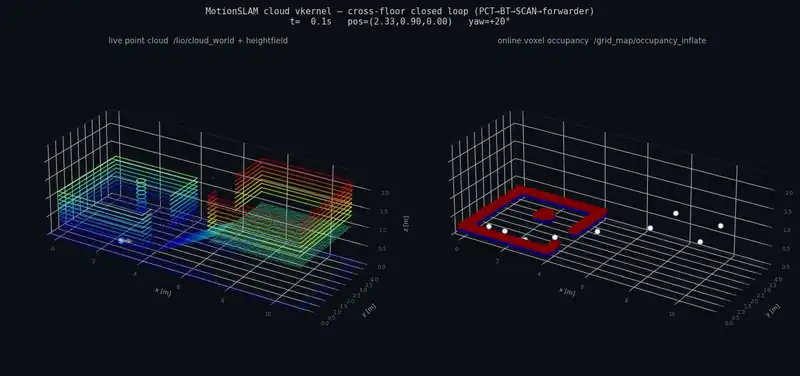

# quadruped-crossfloor-nav-ws

## 项目概述
quadruped-crossfloor-nav-ws 是一个基于 ROS 2 Humble 构建的工作空间，面向四足机器人的跨楼层自主导航任务。
当前以 Unitree Go2 搭载 Livox Mid-360 激光雷达为验证平台，核心的**任务编排、空间状态运行时与控制指令适配**链路均为自研实现，与 Go2 硬件相关的部分集中在转发器（Forwarders）和 Sport API 适配层，迁移到其他四足平台时主要替换这一层（尚未在其他平台上验证）。

### 闭环演示


[完整视频 mp4](docs/media/cross_floor_demo.mp4)

### 真机在线 + Elevator-LIO 数据集场景回放
- **前半段（真机）**：自研导航系统在 Go2 + Livox Mid-360 真机上在线运行时的画面：在线栅格地图与规划路径、实时累积点云、在线点云与俯视地图。
- **后半段（数据集）**：自研轻量化处理管线直接解析 Elevator-LIO 真实 ROS1 bag（`Office9.bag`，Livox MID-360），用 Open3D scan-to-map ICP 配准并累积成场景地图，再以第三人称跟随视角回放：天花板已切除，地面为灰色，墙体按离地高度着色，绿线为传感器轨迹，末尾为全图环视。该段是场景重建回放，不是官方 LIO 结果；完整导航栈在数据集上的回放基线仍在进行中。

Elevator-LIO 数据集（`datasets/Elevator-LIO-Dataset`，18.9 GB，不入库）：20 条序列 / 79 次电梯乘坐，覆盖办公楼/宿舍/校园/商场跨楼层场景。



[完整视频 mp4](docs/media/cross_floor_with_elevator_lio.mp4)

### 核心特性（自研能力）
该工作空间实现了一套稳健且具备容错能力的自主导航技术栈，核心功能涵盖：
- 度量级定位（Metric Localization）
- 全局与局部规划（Global & Local Planning）
- 行为树任务编排（Behavior Tree Orchestration）
- 底层运动控制（Low-level Sport Control）

- **自研**：行为树任务编排（`motionslam_bringup`）、任务运行时（`runtime/task_runtime`）、转发器（Forwarders，含 Sport API 适配）、三空间状态模型。
- **工程集成**：Super-LIO（定位建图）、PCT（全局指引）、SCAN-Planner（局部规划）、unitree_ros2（运动接口）、livox_ros_driver2（雷达驱动），版本见 [THIRD_PARTY.md](THIRD_PARTY.md)。

> 仓库已从 MotionSLAM_ws 更名为 quadruped-crossfloor-nav-ws。ROS 包、Docker 镜像和脚本仍沿用 `motionslam` 前缀（如 `motionslam_bringup`、`scripts/motionslam`），以免影响已部署的构建和启动流程。

### 系统架构亮点
在底层硬件集成之上，该系统自研的"三空间模型"（Three-space Model）规定数据在度量空间（Metric）、符号空间（Symbolic）和世界空间（World）之间如何流转，以及每个空间谁能写、谁不能写：

| 空间 | 存什么 | 谁写 | 谁禁止写 |
|------|--------|------|----------|
| 度量空间 | 几何、占据、可行通行、连续轨迹、限幅速度 | 感知、规划内核、本体控制器 | 世界模型、边端任务 JSON |
| 符号空间 | 技能名、任务生命周期、失败类型、仲裁结果 | 编排 / 技能运行时 | 规划器直写执行速度 |
| 世界空间 | 因果、物体/场景语义、策略记忆、仿真假设 | 边端世界模型 / VLM / 仿真 | `/cmd_vel`、`/motion/command` |

总约束：数据可以跨空间翻译，但**执行只发生在度量空间**。世界空间不得直接下发速度。完整定义见 [架构_端侧系统架构.md](docs/架构/架构_端侧系统架构.md)，其中部分内容是目标架构，并非都已实现。

## 贡献

- **三空间状态化数据流**：空间状态（世界空间）→ 任务意图（符号空间）→ 安全动作（度量空间）→ 新状态，闭环往复
- **可复现闭环**：云端 vkernel 虚拟设备内核中跑通多楼层 11 航点 BT 闭环（PCT → BT → SCAN → Forwarder，SubgoalReached 11/11，见 dev 分支 `docs/云端闭环_vkernel.md`）；真机上已运行在线建图与规划，真机跨楼层闭环尚在验证中
- **任务意图入口**：Thin Harness + task_runtime，intent → task_terminal 验证通过


## 真机部署规范

环境：Jetson Orin NX + Unitree Go2 + Livox Mid-360，ROS 2 Humble（Docker，host 网络直通狗域 0）。

### 核心运行流程
系统的核心运行流程串联了多个关键模块，形成完整的感知-规划-执行闭环：
1. 状态估计：使用 Super-LIO 进行高精度位姿估计。
2. 全局指引：PCT 模块提供全局路径指引。
3. 任务执行：行为树（BT）负责任务调度与执行。
4. 局部规划：SCAN 模块负责局部连续路径规划。
5. 指令适配：通过转发器（Forwarders）适配控制指令。
6. 硬件驱动：最终调用 Unitree Sport APIs 驱动硬件执行。

以下部署步骤即完成上述链路的构建与启动：

```bash
# 1. 拉代码与第三方依赖（按 THIRD_PARTY.md 的 pin）
git clone --recursive https://github.com/zxinyu-robot/quadruped-crossfloor-nav-ws.git
cd quadruped-crossfloor-nav-ws
git submodule update --init   # gitlink 已注册；如所在分支无 gitlink，按
                            # THIRD_PARTY.md 手动 clone + checkout 到 pin
# 2. 构建镜像（Jetson 上，arm64 清华源已在 Dockerfile 内配好）
docker build -t motionslam:humble docker/
# 3. 雷达配置（填现场 Mid-360 IP）
cp MID360_config.example.json MID360_config.json
# 4. 编译（容器内）：主工作区 + SCAN-Planner 工作区（需先打 patches/）
./docker/run_container.sh
./scripts/dev/build_ws.sh                 # 主 colcon 工作区
# scan_planner_ws：clone SCAN-Planner → apply patches/scan-planner-motionslam.patch → colcon build
# 5. 日常运行（一条入口）
./scripts/motionslam nav start            # 起容器 + 起 Demo 栈
./scripts/motionslam nav watch            # 看 /demo/mission/event 关键事件
./scripts/motionslam nav stop             # 急停并停栈
```

注意事项：
- **系统时间**：Jetson 时钟停在 1970 会让 apt/gmake 失败，`build_ws.sh` 会拦截——先在宿主机修 NTP（`scripts/ops/fix_system_time.sh`）
- **环境变量**：`GO2_IP`（狗 IP）、`EDGE_HOST`（边端）、`DEMO_PROFILE=demo_short`、`WITH_FOXGLOVE/WITH_EDGE_UPLINK/...` 开关见 `scripts/nav/start_demo_scan_nav.sh`
- **参数基线**：真机以 `config/demo_scan_planner.yaml` 为准；云端 overlay `demo_scan_planner_cloud.yaml` 放宽了动力学与障碍 z 过滤（`obstacle_height_max` 1.5→3.0），**不得回灌真机**
- **跨楼层**：真机 `obstacle_height_max=1.50` 相对地面会滤掉楼上墙体，跨楼层部署前需改相对机器人/分层地图
- **透明障碍**：仅保留类别无关 `virtual_obstacle_merge` 管道，玻璃专用策略已按规划文档移除

## 参考工作

- [Super-LIO](https://github.com/Liansheng-Wang/Super-LIO)（`ros2` 分支）— 定位与建图
- [SCAN-Planner](https://github.com/wuyi2121/SCAN-Planner)（`ros2-community` 分支）— 局部规划与轨迹控制
- [PCT_planner](https://github.com/VectorRobotics/PCT_planner) — 全局路径规划
- [unitree_ros2](https://github.com/unitreerobotics/unitree_ros2) — Go2 运动接口
- [livox_ros_driver2](https://github.com/Livox-SDK/livox_ros_driver2) — Mid-360 驱动

## 关联项目

以下是同一体系的独立仓库，不是本仓库的子模块，按需集成。

**同体系的其他平台**
- [legged-navigation-runtime](https://github.com/zxinyu-robot/legged-navigation-runtime) — Unitree G1/H2 双足端侧自主导航闭环（脱敏重构）；其 `RecoveryPlugin` 已通过 `runtime/task_runtime` 的恢复桥接入本仓库
- [CleanRobot-Sim2Real-skill](https://github.com/zxinyu-robot/CleanRobot-Sim2Real-skill) — 复合清洁机器人（移动底盘 + xArm）的操作技能学习与评测（MuJoCo 仿真）

**空间运行时与通信**
- [ForkSpatial-Runtime-Engine](https://github.com/zxinyu-robot/ForkSpatial-Runtime-Engine) — 空间状态契约、语义 Token、ESN 时序记忆与任务编排运行时
- [Swarm Spatial Link](https://github.com/zxinyu-robot/swarm-spatial-link) — 面向多机器人弱网协同的自适应通信中间件
- [Multi-Robot Map Fusion](https://github.com/zxinyu-robot/multi-robot-map-fusion) — 共享内存数据路径与版本化子图融合核心

**导航与安全**
- [SensorGuardNav-Runtime](https://github.com/zxinyu-robot/SensorGuardNav-Runtime) — LiDAR 受污染时的定位自救运行时
- [Legged Terrain State](https://github.com/zxinyu-robot/legged-terrain-state) — 四足机器人地形状态契约、可通行性评估与安全降级

**学习与诊断**
- [Interactive Nav Learning](https://github.com/zxinyu-robot/interactive-nav-learning) — 支持中途纠正的行为克隆与 DAgger 导航学习基线
- [SlamDoctor-Runtime](https://github.com/zxinyu-robot/SlamDoctor-Runtime) — 基于运行证据与故障图的 SLAM 导航诊断 CLI
