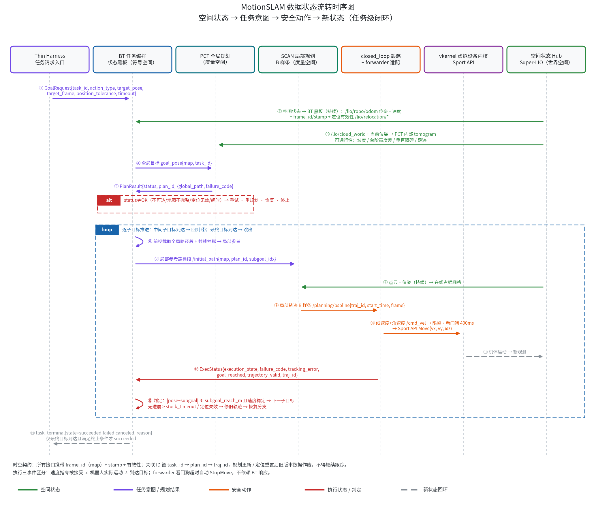
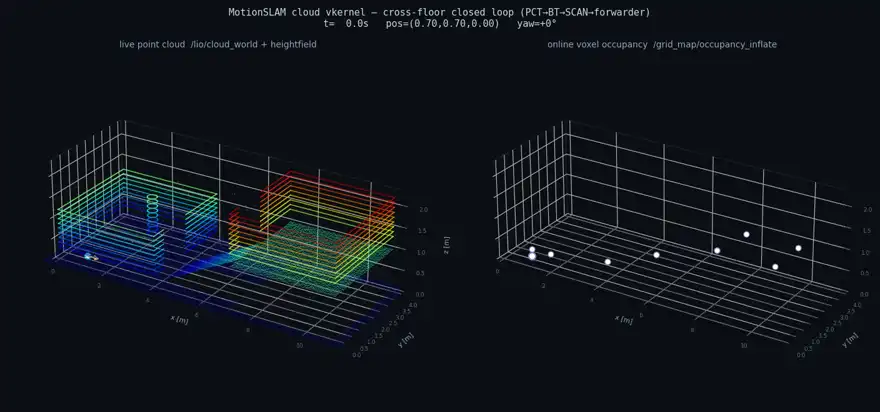

# MotionSLAM_ws

Unitree Go2 + Mid-360 端侧**跨楼层自主探索导航**（ROS 2 Humble）：面向工程落地的四足机器人自主定位、探索与导航，带故障恢复机制。链路：Super-LIO 定位 → PCT 全局规划 → BT 任务编排 → SCAN 局部规划 → forwarder → Sport 运动执行；核心规划/执行/运行时均为 C++ 实现。

## 贡献

- **三空间状态化数据流**：空间状态（世界空间）→ 任务意图（符号空间）→ 安全动作（度量空间）→ 新状态，闭环往复
- **云端可复现闭环**：vkernel 虚拟设备内核，无真机跑通全链路（多楼层 11/11 `mission_succeeded`）
- **任务意图入口**：Thin Harness + task_runtime，intent → task_terminal 验证通过



## 真机部署规范

环境：Jetson Orin NX + Unitree Go2 + Livox Mid-360，ROS 2 Humble（Docker，host 网络直通狗域 0）。

```bash
# 1. 拉代码与第三方依赖（按 THIRD_PARTY.md 的 pin）
git clone --recursive https://github.com/zxinyu-robot/MotionSLAM_ws.git
cd MotionSLAM_ws
git submodule update --init   # gitlink 已注册；如所在分支无 gitlink，按
                            # THIRD_PARTY.md 手动 clone + checkout 到 pin
# 2. 构建镜像（Jetson 上，arm64 清华源已在 Dockerfile 内配好）
docker build -t motionslam:humble docker/
# 3. 雷达配置（填现场 Mid-360 IP）
cp MID360_config.example.json MID360_config.json
# 4. 编译（容器内）：主工作区 + SCAN-Planner 工作区（需先打 patches/）
./docker/run_container.sh
./scripts/dev/build_ws.sh                 # 主 colcon 工作区
# scan_planner_ws：clone SCAN-Planner → apply patches/scan-planner-motionslam.patch → colcon build
# 5. 日常运行（一条入口）
./scripts/motionslam nav start            # 起容器 + 起 Demo 栈
./scripts/motionslam nav watch            # 看 /demo/mission/event 关键事件
./scripts/motionslam nav stop             # 急停并停栈
```

注意事项：
- **系统时间**：Jetson 时钟停在 1970 会让 apt/gmake 失败，`build_ws.sh` 会拦截——先在宿主机修 NTP（`scripts/ops/fix_system_time.sh`）
- **环境变量**：`GO2_IP`（狗 IP）、`EDGE_HOST`（边端）、`DEMO_PROFILE=demo_short`、`WITH_FOXGLOVE/WITH_EDGE_UPLINK/...` 开关见 `scripts/nav/start_demo_scan_nav.sh`
- **参数基线**：真机以 `config/demo_scan_planner.yaml` 为准；云端 overlay `demo_scan_planner_cloud.yaml` 放宽了动力学与障碍 z 过滤（`obstacle_height_max` 1.5→3.0），**不得回灌真机**
- **跨楼层**：真机 `obstacle_height_max=1.50` 相对地面会滤掉楼上墙体，跨楼层部署前需改相对机器人/分层地图
- **透明障碍**：仅保留类别无关 `virtual_obstacle_merge` 管道，玻璃专用策略已按规划文档移除

## 云端闭环演示



[完整视频 mp4](docs/media/cross_floor_demo.mp4)

## 参考工作

- [Super-LIO](https://github.com/Liansheng-Wang/Super-LIO)（`ros2` 分支）— 定位与建图
- [SCAN-Planner](https://github.com/wuyi2121/SCAN-Planner)（`ros2-community` 分支）— 局部规划与轨迹控制
- [PCT_planner](https://github.com/VectorRobotics/PCT_planner) — 全局路径规划
- [unitree_ros2](https://github.com/unitreerobotics/unitree_ros2) — Go2 运动接口
- [livox_ros_driver2](https://github.com/Livox-SDK/livox_ros_driver2) — Mid-360 驱动

## 关联项目

**空间运行时与通信**
- [Fork Spatial Runtime](https://github.com/zxinyu-robot/fork-spatial-runtime) — 增量空间状态、因子校验与原子图事务运行时
- [Swarm Spatial Link](https://github.com/zxinyu-robot/swarm-spatial-link) — 面向多机器人弱网协同的自适应通信中间件
- [Multi-Robot Map Fusion](https://github.com/zxinyu-robot/multi-robot-map-fusion) — 共享内存数据路径与版本化子图融合核心

**导航与安全**
- [Legged Navigation Runtime](https://github.com/zxinyu-robot/legged-navigation-runtime) — 双足机器人故障恢复定位与多楼层导航运行时
- [Legged Terrain State](https://github.com/zxinyu-robot/legged-terrain-state) — 四足机器人地形状态契约、可通行性评估与安全降级

**学习与诊断**
- [Interactive Nav Learning](https://github.com/zxinyu-robot/interactive-nav-learning) — 支持中途纠正的行为克隆与 DAgger 导航学习基线
- [SlamDoctor](https://github.com/zxinyu-robot/SlamDoctor) — 基于运行证据与故障图的 SLAM 导航诊断 CLI
