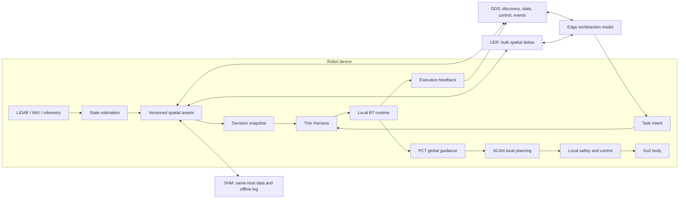

# MotionSLAM

<p align="center">
  <strong>空间状态 → 任务意图 → 安全动作 → 新状态</strong><br>
  Linux-native runtime direction for legged-robot autonomy
</p>

> **Repository snapshot:** public, desensitized GitHub backup. The historical Go2 integration is documented separately from the new runtime target. Current targets are not claims of completed or hardware-validated features.

## At a glance

| Verified implementation snapshot | Runtime target — not yet validated |
|---|---|
| Go2 navigation chain: Super-LIO → PCT C++ → BT → SCAN → Sport | Linux-native task/state runtime; ROS 2 overlay remains frozen and untouched |
| 1 m board navigation recorded at 0.43 m arrival offset on 2026-08-19 | Versioned spatial asset graph, decision snapshots, and three stable APIs |
| Edge task closure, long-duration soak, and 3D relocalization recovery remain unverified in the cited snapshot | DDS + SHM + UDP data foundation; event-triggered task replanning |

## System view



The diagrams and implementation status are intentionally separated: the local planner and controller retain execution authority; the edge sends task intent, never velocity commands or BT tree serialization. Spatial state may update continuously. The device handles changes locally while task constraints remain valid and requests global replanning only when reachability, preconditions, or task ordering are affected.

## Current navigation chain

The existing hardware integration snapshot uses:

```text
Super-LIO → pct_resident_planner → BT /initial_path → SCAN navi_mode=3
          → closed_loop_controller → cmd_vel_forwarder → Sport
```

PCT provides global guidance; BT is the unique execution-path writer; SCAN tracks the approved path and produces local continuous motion. Nav2 is not the main planning chain. Any Nav2 plugin experiment belongs on a separate branch and must not modify the frozen ROS 2 overlay.

### Recorded evidence

- `BOARD-CL`, 2026-08-19: 1.0 m target; recorded strict arrival offset 0.43 m.
- Edge task closure (`EDGE-CL`), return-home recovery, dynamic-obstacle handling, and soak testing are not marked complete in the linked snapshot.
- The Linux-native `runtime/task_runtime` is an initial C++20 lifecycle scaffold. It is not yet connected to Thin Harness, BT, PCT, or SCAN; its CMake/CTest run has not been executed in this VFS session.

See [test records](docs/测试验收/测试记录.md) for the dated evidence and [the runtime roadmap](docs/规划/项目规划_空间状态运行时.md) for the target and gates.

## Try the existing hardware stack

These commands apply to the historical Go2 integration environment, not to the standalone Linux runtime core. Keep the existing ROS 2 overlay unchanged.

```bash
# Build the existing Humble image, if not already available
docker build -t motionslam:humble docker/

# On the robot host: release Mid-360 from Unitree SLAM
./scripts/motionslam stop-slam

# Enter the project container
./docker/run_container.sh

# Inside the container: build the existing integration stack
./scripts/motionslam build
cd scan_planner_ws && colcon build --symlink-install && cd ..
source /ws/scripts/dev/source_ws_env.sh
ros2 topic list | grep rt/
```

For robot-specific prerequisites and safe start/stop steps, see the [3D demo runbook](docs/运维/Demo阶段3D_runbook.md). Do not start motion on hardware without the required operator and emergency-stop safeguards.

## Linux-native runtime scaffold

The initial lifecycle core is outside the ROS 2 overlay and has its own CMake/CTest project:

```bash
cmake -S runtime/task_runtime -B build/runtime-task -DCMAKE_BUILD_TYPE=Debug
cmake --build build/runtime-task
ctest --test-dir build/runtime-task --output-on-failure
```

It currently covers basic task lifecycle, skill sequence progression, and fail-closed safety interlocks. It does not yet implement asset-version validation, scheduling/preemption, Thin Harness integration, or BT/PCT/SCAN adapters.

## Documentation

| Start here | What it covers |
|---|---|
| [Runtime roadmap](docs/规划/项目规划_空间状态运行时.md) | Current target, module boundaries, stages, and acceptance gates |
| [System architecture](docs/架构/架构_端侧系统架构.md) | Spatial layers, APIs, runtime ownership, and deployment target |
| [Edge interface specification](docs/项目规范/边端协同接口规范.md) | Three API contracts and legacy envelope compatibility |
| [Test records](docs/测试验收/测试记录.md) | Dated implementation and robot evidence |
| [Demo 1 archive](docs/规划/项目规划_Demo1三步.md) | Original work packages and 2026-08-19 history |
| [Operations runbook](docs/运维/Demo阶段3D_runbook.md) | Existing Go2 integration start/stop procedures |

## Repository map

| Path | Role |
|---|---|
| `src/motionslam_pipeline` | Existing C++ planner, local map, and forwarding integration |
| `src/motionslam_bringup` | Existing launch, BT orchestration, and edge compatibility code |
| `src/motionslam_ipc` | Existing POSIX shared-memory point-cloud/map path |
| `runtime/task_runtime` | Standalone Linux-native lifecycle core scaffold |
| `docker/`, `scripts/` | Existing integration environment and operational tooling |

**Source of truth:** this GitHub repository is a desensitized backup. The integrated development remote and its current status must be checked before treating this snapshot as the latest implementation or running hardware validation.
